<h1 align="center">網 金 游 俠</h1>
<p align="center"><strong>青溪失鏢 · 四人同行，一段有選擇的江湖。</strong></p>
<p align="center">A Godot wuxia RPG about companions, martial arts, and battles you can read—and outthink.</p>
<p align="center">
  <a href="https://github.com/chon9/Jinyong-Emulator/releases/latest">Download Windows</a> ·
  <a href="https://jy.chon9.com">瀏覽器版</a> ·
  <a href="#play-with-friends">Play with friends</a> ·
  <a href="docs/DEVELOPMENT.md">開發與玩法手冊</a>
</p>

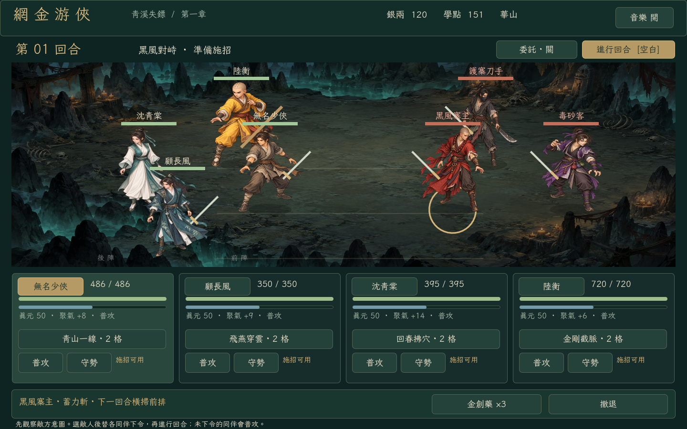

## 一枚斷鏢，牽出一整座鎮的秘密

鏢隊失蹤，救命的藥材不知去向。你帶著一封舊信來到青溪，遇見一個被除名的劍客、一位不願旁觀的醫者，和一個總是站在別人前面的棍衛。有人要你燒掉密信，有人只想讓藥送到。

**v0.7.0 changes the default game into a visual, character-first chapter.** Explore eight connected places, recruit a four-person party, investigate the missing shipment, choose how to handle the evidence, and fight through to an awarded ending. The optional herb quest, merchant, training master and boss rematch all work in the same loop.

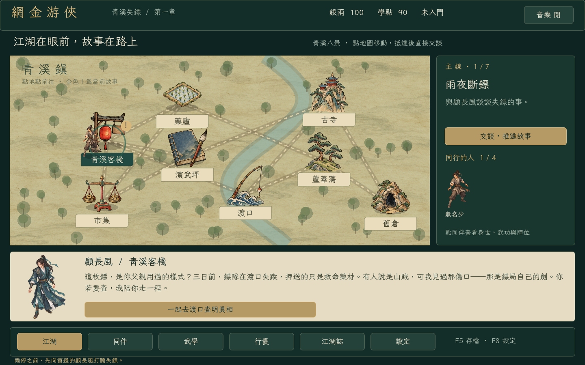

Click a named place to travel. The gold **!** and pinned quest button identify the next clue. NPC dialogue and choices stay below the map, where you can actually accept and advance the story.

## 戰鬥，從留一手開始

Plan each companion's action, then let speed decide the order. A basic attack by either side gives every living fighter a **聚氣** pulse. Active arts spend **真元** and require **調息**; **25 真元 = one energy segment**. Use manual orders or enable 委託, and turn it off to plan the next round yourself.

| Companion | What they bring to the fight |
| --- | --- |
| 無名少俠 | Apply bleeding, then exploit bleeding or broken armour for **30% extra damage**. Sect training can unlock a cleaving sword art or armour-breaking palm. |
| 顧長風 | A fast sword strike that can **target the rear rank**. Reach the poison thrower before he wears the party down. |
| 沈青棠 | Heal the ally with the lowest health ratio and **cleanse poison and bleeding**. Protect her while she gathers qi. |
| 陸衡 | **Interrupt the chief's charged strike** or guard the rear rank. A well-timed staff matters more than another ordinary attack. |

Melee must break the front rank first. Change upper/middle/lower lanes and front/rear positions in **同伴**; occupied slots swap cleanly. Equip one **外功**, **內功** and **輕功** per character under **武學**. Inner arts trade qi generation for health and defence; light arts trade initiative for evasion. The matching weapon type follows the outer art.

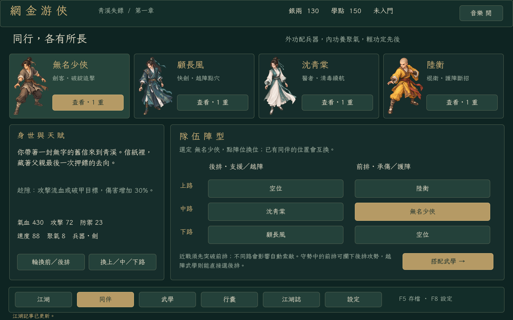

At the training ground, choose **華山、武當 or 少林**. Spend learning points with the master, or self-study in timed five-second cycles. Progress improves real combat stats. Advanced Huashan swordsmanship checks your sect, three levels of mastery, a battle victory and its learning-point cost.

The chapter uses **custom balance and original fiction**, inspired by the party-and-exploration direction of 《煙雨江湖》. It is a complete first chapter, not a claim to reproduce either game's entire world, official combat formulas or artwork. See [chapter rules and research](docs/JOURNEY.md).

## 在瀏覽器展開江湖

The same Godot 4.6.3 game runs on **Windows and the web**, hosted with Sites. Open the [browser edition](https://jy.chon9.com) and choose **進入江湖**, or [download the latest Windows ZIP](https://github.com/chon9/Jinyong-Emulator/releases/latest) and run `Youxia.exe`. Five scene-aware BGM tracks accompany both editions. The homepage and persistent web toolbar always link to the latest Windows release.

The first visit downloads roughly **58 MB** including the engine, chapter art and soundtrack. Use a modern WebGL 2 browser on desktop or a tablet in landscape. Browser saves stay in IndexedDB. The top toolbar can **匯出存檔／匯入存檔**, including Windows backups. The new chapter and existing classic character share one backup with separate progression fields; neither overwrites the other. Clearing browser storage can remove progress; inactive tabs can pause self-study.

**New chapter: single-player party combat.** The existing classic game remains under **設定 → 進入舊版江湖 / F9**, with a **青溪新章** button to return. Its large catalogue, multiplayer, dungeons and life skills have not all been converted to the new party system.

Classic multiplayer uses **WebSocket** in the browser with the existing authoritative host. The Site does **not** include a cloud game host; browser clients cannot use Steam or UDP. Run a native WebSocket host and enter its **wss://** address under the classic **系統** page. Native LAN and Steam support remain available in the classic game.

See [browser export, saves and hosting](docs/WEB.md) for the build workflow, verification and current limits.

## 經典江湖 · 保留的舊版玩法

The following catalogue and sections describe the retained classic game, accessible from Settings. They are **not** counts for the new Qingxi chapter.

| Explore | Meet | Collect | Challenge |
| :---: | :---: | :---: | :---: |
| **270** connected locations | **293** NPCs with distinct dialogue | **174** items | **137** enemy types |
| **11** sects | **12** character storylines | **124** martial arts | **71** artifact commissions |

## 接任務、買補給，從這裡開始

The permanent top bar puts **任務 · 商店 · 行囊** within one click. You can also use the matching lantern menus.

- **任務** — Browse available, active, locked and completed quests. Select one to see its requirements, rewards and next step. Common quests remain visible after joining a sect. Press **前往接任務**, then accept beside the NPC; delivery and reward buttons live in the same journal.
- **商店** — Choose **購買物品** or **出售物品**, select an item and quantity, and confirm the displayed total. Missing money, protected quest items and equipped gear have visible explanations. If no merchant is nearby, the shop finder lists reachable stores and starts travel when selected.
- **行囊** — Use medicine, equip or remove gear, or jump directly to its sale. The shop can also remove equipped gear before you sell it.

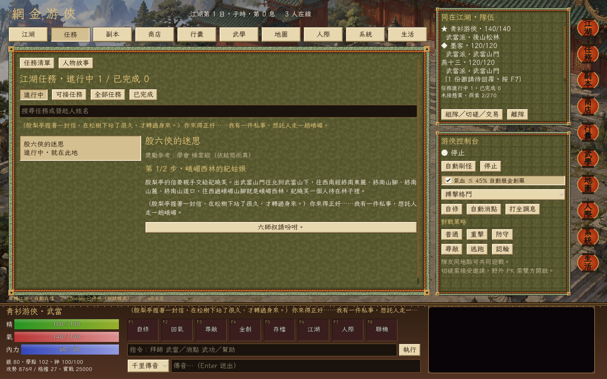

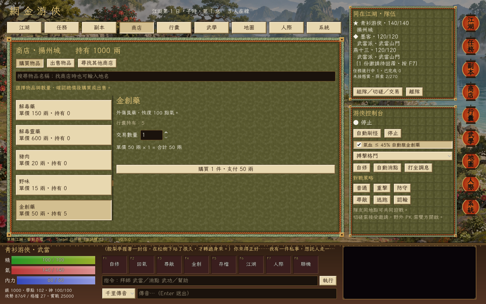

## 任務與副本，開始下一段江湖

**20 new source stories** include 金盆洗手上下篇、雲兒、尋找楊康、程清霜送藥、清為尋木、全真送信 and 雁門關拓印. Quest pages now expose scene actions, timed encounters, collection and kill progress. Repeatable quests show cooldowns and retain their completion history.

Open **副本**, choose an entrance and travel there. Solo players can enter directly; parties gather at the entrance and let the leader create the instance. **Every member must ready up before each stage.** Heal between stages, use your own medicine to aid a teammate, and finish all three stages for automatic rewards.

| Instance | Entrance | Required 實戰 | Suggested martial level |
| --- | --- | ---: | --- |
| 黑風寨剿匪 | 黑風林 | 0 | 5 |
| 銅人試陣 | 少林寺・羅漢堂 | 1,000 | 15–25 |
| 血刀密窟 | 血刀門・密室 | 4,000 | 25–35 |
| 高昌秘窟 | 高昌・高昌迷宮外 | 12,250 | 40+ |

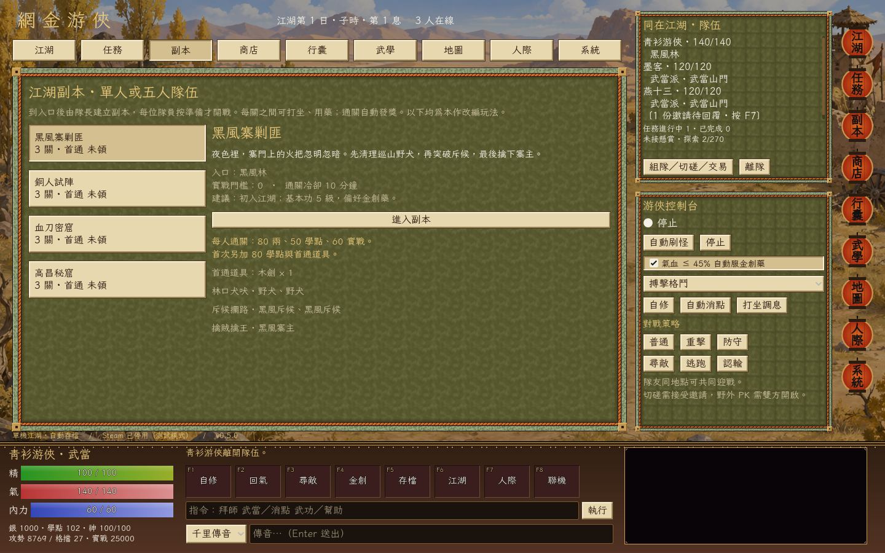

Each remaining participant receives one clear reward; the first clear also grants a bonus item and learning points. Cooldowns last 10–30 real minutes. Leaving or losing grants no partial clear reward. Awarded items, clear history and cooldowns persist; unfinished instances reset on reconnect. These are simulator adaptations; the bronze trial does not replace the original sect graduation exam.

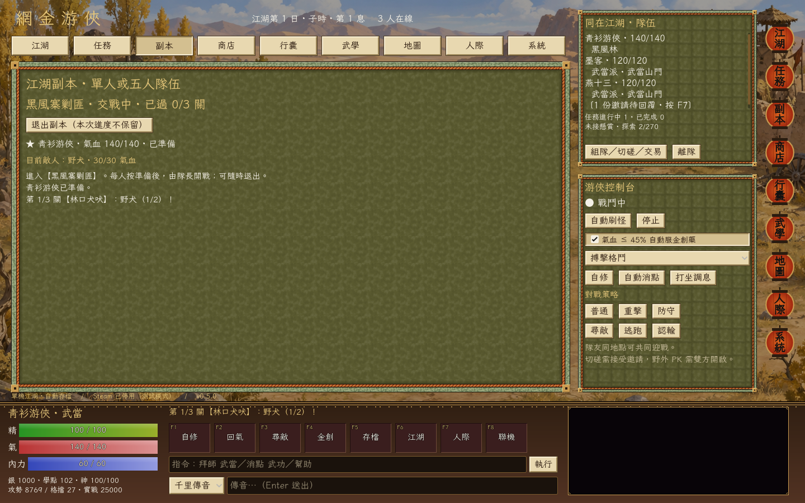

Four linked **討伐委託** are available from 揚州城's 江湖懸賞使. Their quest panels link directly to the dungeon page. Complete the instance, then return to the quest journal for the separate bounty.

## 採一簍礦，打一柄自己的劍

**v0.6.0 adds life-skill automation.** Open **生活** in the top bar or press **Ctrl+0**. Choose a skill, follow **尋師** to its teacher, pay the lesson fee and receive its starter tool. The page finds the nearest suitable workplace and shows tools, ingredients, proficiency, success chance and the next action.

**11 skills · 38 recipes · 62 workplaces:** 種田、樵夫、釣魚、廚師、挖礦、打鐵、鑄劍、工匠、織布、裁縫、獵人。

- Choose **1 / 10 / 30 / 100 attempts** or keep working until stopped. Optional **自動打坐** restores energy and resumes work; missing materials or tools still stop the job.
- Turn ore into bars, bars into weapons and tools; spin hemp into thread, weave cloth, then sew clothes. Missing materials link to their gathering skill, recipe or shop. Finished products and harvested goods link directly to selling.
- Each completed attempt spends energy. Success earns proficiency and products; failed crafts keep their ingredients. Hunting uses your actual martial arts in a solo battle, with meat and hides awarded after victory.
- The host owns timers, checks, consumption and rewards in multiplayer. Stop, travel, battle interruptions or loading a save cancel pending work. Proficiency and inventory persist; **there are no offline earnings**.

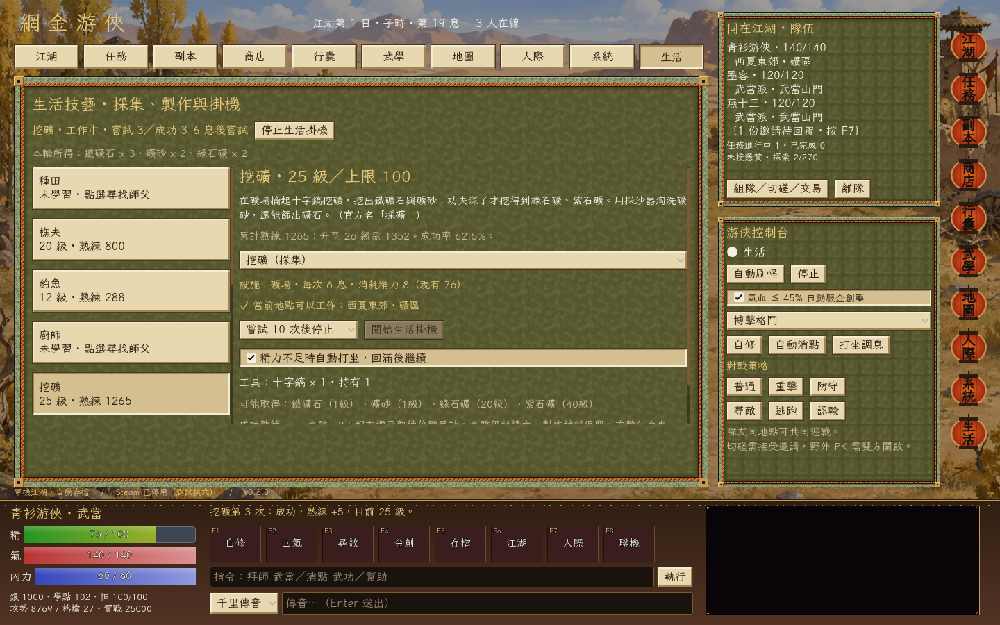

The life data comes from the supplied JY-Mini OL project. Its proposed recipes, teacher placements and numerical rules retain their source labels; this is not a claim of exact official-server economy. See [life rules and verification](docs/LIFE_SKILLS.md).

## Learn the art. Find your way.

- **門派與師承** — Join 少林、武當、峨嵋、華山、恆山、全真、古墓、靈鷲宮、星宿、血刀門 or 丐幫. Find teachers, meet prerequisites, and work through their teaching limits.
- **消點與自修** — Spend learning points to gain proficiency. 悟性 changes training efficiency; ordinary self-study consumes points and energy every complete five-second cycle. Teachers, basic skills, combat experience and quests constrain progression.
- **游俠控制台** — Automate hunting, instruction, self-study, and healing. Medicines are consumed from your actual inventory; automation stops when conditions cannot be met.
- **故事與探索** — Follow character conversations inspired by Jin Yong's stories, make choices, search for artifacts, and deliver commissions. A searchable codex helps you find people and routes.
- **經典介面** — Parchment, jade, lanterns, a calligraphic font, illustrated landscapes, and a bottom hotbar adapted from JY-Mini OL.
- **江湖聲韻** — Five BGM tracks, scene-aware switching, crossfades, volume and mute controls, and a manual track selector. Preferences are saved locally.

`拜師 → 刷怪 → 學點 → 消點／自修 → 更深的江湖`

### Find the person. Learn the art.

**Find a teacher or a quest giver by name or martial art.** Search the map for a place, person, martial art or learning event. Searching **武當心法** finds its actual teacher; an event art can point to its quest giver. Results show the exact room and distance.

Choose a result to **start travelling immediately**. The world page shows the destination, next stop and full route. Travel follows adjacent rooms one step at a time, stops on arrival, and can be cancelled with **停止**. Changing destination cancels the old journey.

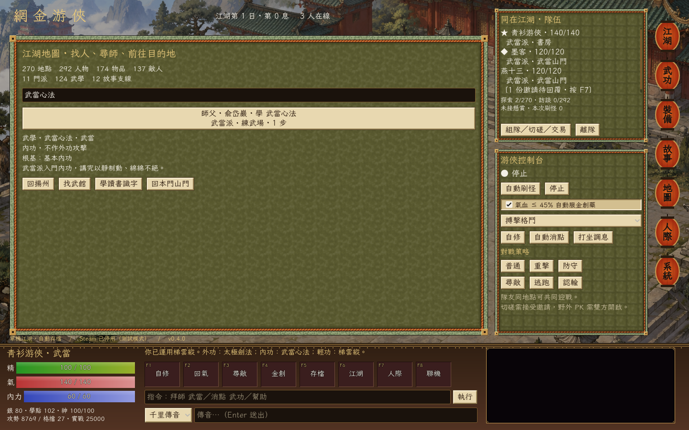

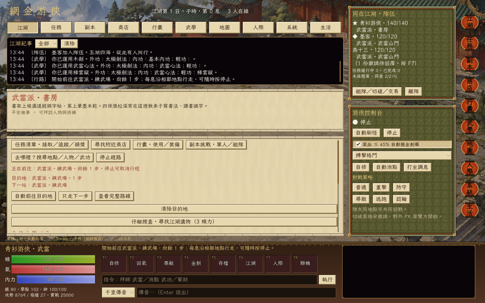

Instruction now spends **one point for proficiency**, rather than granting a full level. Self-study spends **three points every five seconds**, with no credit for an interrupted cycle. Train 讀書識字 to improve 悟性, build lifetime 實戰, meet the teacher's prerequisites, and complete learning events to unlock advanced arts. The 武功 page shows what is missing.

The **49 imported quest definitions** include recommendation letters, conversations, items, trials and learning rewards. This release verifies 26 complete primary quest paths, including the new stories and four previously blocked routes. It does not claim all reference quests or every branch are complete. External, internal, lightness and parry arts have separate selections; combat includes corresponding basic skills, equipment scaling, dodge, move unlocks and inner-power costs.

See the [research and implementation audit](docs/RESTORATION.md) for sources, historical differences and reconstructed coefficients. This build does not claim exact official-server parity.

### Match your art to your weapon

**v0.3.1 fixes martial-art and weapon matching.** The 武功 page shows each art's category, required weapon, foundation and self-study limit. Equip an external art, an internal art and a lightness skill independently.

| Martial art | Required equipment |
| --- | --- |
| 搏擊格鬥 / 基本刺術 / 拳掌指法 | Unarmed or a claw weapon |
| 劍法 / 刀法 | Sword / blade respectively |
| 棍杖 / 槍法 / 鞭法 | Staff / spear / whip respectively |
| 倚天屠龍筆法 | Spear category, following the official classification |
| 內功 / 輕功 | Separate support slots; cannot replace your attack |

Learn **基本劍法** from a teacher before equipping **木劍**. Equipping a weapon selects a compatible art you already know. Use **行囊 → 卸下兵器** to return to unarmed arts. A sword no longer adds damage to fist or staff techniques.

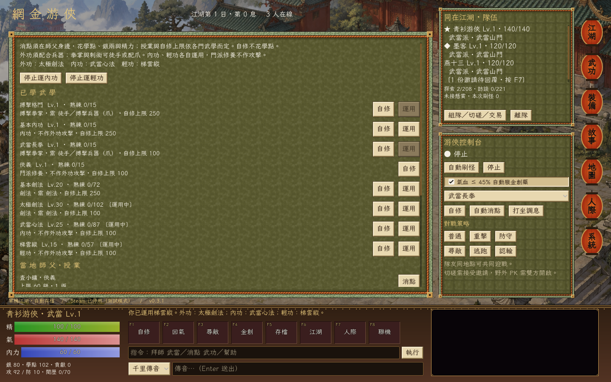

The original basic name **搏擊格鬥** replaces the prototype's 基本拳腳. Old levels and proficiency migrate automatically. See [the rules and sources](docs/MARTIAL_RULES.md) for verified classifications and remaining simulator adaptations.

## Start playing

1. Download the Windows ZIP from [Releases](https://github.com/chon9/Jinyong-Emulator/releases/latest).
2. Extract **all files** into a folder.
3. Double-click **Youxia.exe**. Godot and Python are not required.

Keep the bundled DLLs and `steam_appid.txt` next to the EXE. The game opens in single-player mode and remains playable when Steam is unavailable.

**First steps:** open **任務 → 可接任務** and choose a beginner delivery. Press **前往接任務**, accept at the NPC, follow the next step and claim the reward. Open **商店** for supplies and selling loot. For training, open 地圖 and search **基本刀法** or **基本劍法** to find a武館 teacher. Learn a basic art, return to 揚州城 for the beginner bounty, then work toward your chosen sect's entry requirements. Set gender in 武功 before joining; 武當 and 華山 also need their entry events. Press **F8** for music settings and multiplayer connections.

| Key | Action | Key | Action |
| --- | --- | --- | --- |
| **F1** | 自修 · self-study | **F5** | Save |
| **F2** | 打坐 · meditate | **F6** | Return to the world |
| **F3** | 尋敵 · seek enemies | **F7** | Player interactions |
| **F4** | Use 金創藥 | **F8** | Music & connections |

**Ctrl+1–9** opens 江湖、任務、副本、商店、行囊、武學、地圖、人際、系統; **Ctrl+0** opens 生活; **Esc** returns to the world. The command line also accepts commands such as `拜師 武當`, `自修 基本內功`, `掛機 刷怪`, and `幫助`.

## Play with friends

Build a party of up to **five players**, follow the leader, fight the same enemies, share rewards, and heal an ally with your own medicine. Party chat and private messages go only to their intended recipients.

For a friendly contest, send a **duel invitation**. Both players must agree; health and inner power return to their pre-duel values afterwards. For **wilderness PK**, both players must enable PK, and safe zones remain protected. The loser returns to town with PK switched off.

Trade face to face: choose an item, quantity, and price, then let the other player accept. Items and silver move together after a final inventory check. A price of zero makes it a gift.

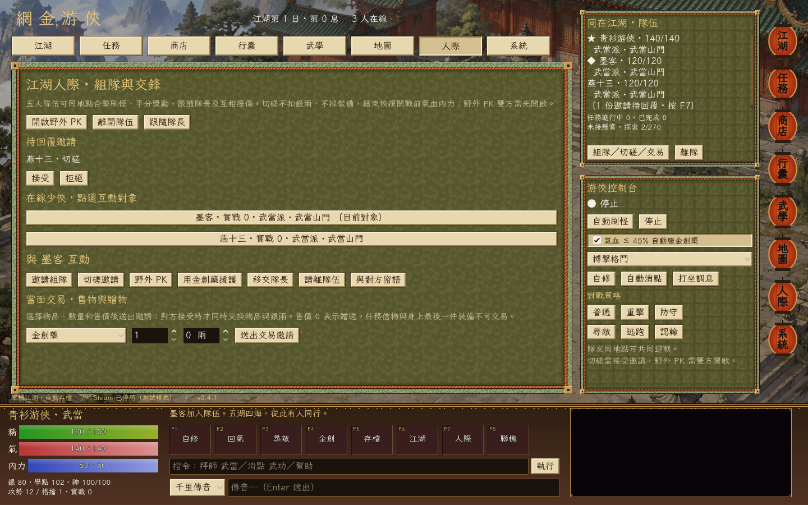

### Steam / Spacewar 480

Both players should run the **same game version**, sign into different Steam accounts, and start the game first. The host opens **系統 / F8 → Steam 開房** and shares the lobby ID or uses the invite overlay. Friends join using the lobby ID or Steam invitation.

### LAN / direct connection

Use **區網開房** on the host, then connect to the host's IP. The game uses **UDP 24780**; `127.0.0.1` works for two instances on one computer. Internet direct connections require suitable router/firewall configuration.

The host owns the world and calculates combat, rewards, learning, and trades. Guests' progress is saved by that host. Parties, invitations and unfinished fights are session-only; character progress persists. Host migration is not implemented.

**Verification:** two-process LAN tests cover following, shared battles, trading, duels, PK, private chat and reconnecting. Steam initialization and lobby creation are tested; cross-machine play with two Steam accounts still needs hands-on verification.

## A soundtrack for the road

Town, wilderness, dungeon, ordinary battle, and boss encounters select different tracks. Transitions crossfade, repeated state updates do not restart a song, and combat can return you to the previous ambient playback position. Choose a favorite track or mute the music in **系統 / F8**.

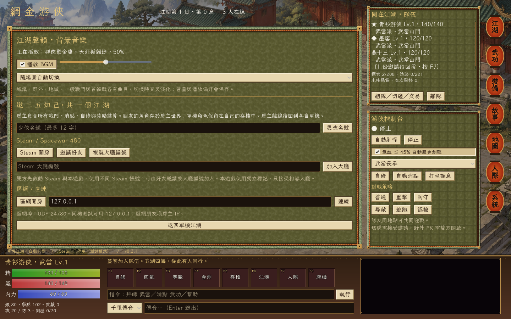

## Saves that stay with you

The standalone Windows game saves to:

```text
%APPDATA%\Godot\app_userdata\網金游俠模擬器\
```

Progress saves every 30 seconds, on F5, and on exit; chapter choices and completed actions also save immediately. A `.bak` copy supports recovery from a damaged main save. Music preferences are separate from character progress. Older characters retain learned levels and items; within-level progress migrates proportionally to the new curve. Travel, combat, unfinished dungeon runs and incomplete study or life-work cycles reset on load. Life proficiency, awarded dungeon rewards and clear records persist. Quest waits retain elapsed world time; repeat cooldowns use real time. Everyone in a classic multiplayer session should use the same build; the transport remains **protocol 7**.

## Build from source

Use **Godot 4.6.3 standard**, with the matching Windows export template. GodotSteam 4.23 is bundled; no separate Steam plugin installation is needed.

```powershell
# Import and run using your own Godot executable
.\tools\run.ps1 -Godot 'D:\Godot\Godot_v4.6.3-stable_win64_console.exe' -Headless -NoSteam -Import
.\tools\run.ps1 -Godot 'D:\Godot\Godot_v4.6.3-stable_win64_console.exe'

# Tests, including local networking
.\tools\test.ps1 -Godot 'D:\Godot\Godot_v4.6.3-stable_win64_console.exe'
.\tools\test.ps1 -Godot 'D:\Godot\Godot_v4.6.3-stable_win64_console.exe' -SocialNetwork

# Windows release ZIP
.\tools\export_windows.ps1 -Godot 'D:\Godot\Godot_v4.6.3-stable_win64_console.exe'
```

The launcher isolates development saves and editor caches under `.tools/`; they are separate from the EXE's normal Windows saves. Release ZIPs go under `build/`. Neither directory is committed.

| Area | Source |
| --- | --- |
| World rules, learning, encounters | [`scripts/world.gd`](scripts/world.gd) |
| Parties, shared fights, PvP, trades | [`scripts/social.gd`](scripts/social.gd) |
| Host authority, snapshots, persistence | [`scripts/session.gd`](scripts/session.gd) |
| Steam lobbies and invites | [`scripts/steam_bridge.gd`](scripts/steam_bridge.gd) |
| Music playback and preferences | [`scripts/bgm.gd`](scripts/bgm.gd) |
| Life work, recipes, learning and automation | [`scripts/life_skills.gd`](scripts/life_skills.gd), [`data/life_skills.json`](data/life_skills.json) |
| Classic UI and controls | [`scripts/classic/`](scripts/classic/) |
| World catalog and stories | [`data/`](data/) |

See [new chapter rules and research](docs/JOURNEY.md), the [classic development and gameplay manual](docs/DEVELOPMENT.md), the [classic restoration audit](docs/RESTORATION.md), and [v0.7.0 release notes](docs/releases/v0.7.0.md).

## Project notes & credits

This is a playable simulator with its own balancing and simplified rules. It does not claim exact parity with a particular historical 網金游俠 version. Character storylines are newly written adaptations, not verbatim novel text; characters from multiple works share this simulated world.

Content, classic UI components, landscape art, and music were supplied through the owner's **JY-Mini OL** project. **LXGW WenKai TC** uses the [SIL Open Font License](assets/fonts/OFL.txt); **GodotSteam** includes its [MIT license](addons/godotsteam/LICENSE.txt). Soundtrack recordings retain their respective owners' rights; see [music provenance](assets/bgm/SOURCE.txt). These third-party notices do not grant a blanket license to all game assets.
