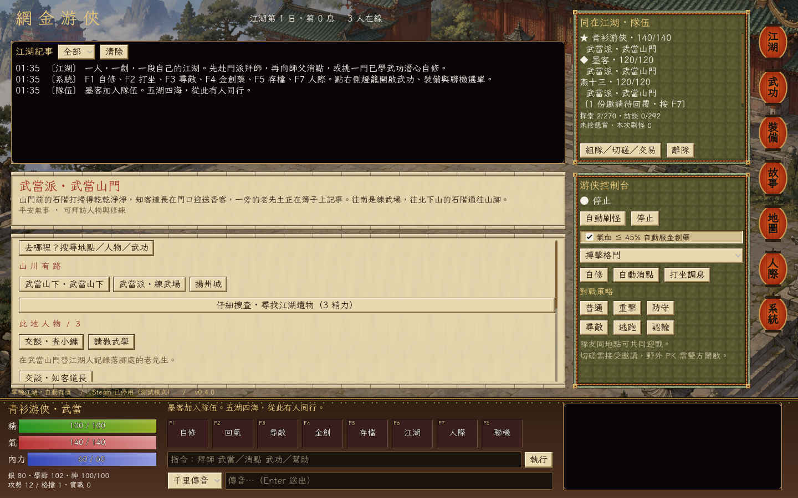

<h1 align="center">網 金 游 俠</h1>
<p align="center"><strong>Jinyong Emulator · 一人一劍，也能共闖江湖。</strong></p>
<p align="center">A text-driven wuxia RPG with classic Chinese MMO styling, martial-arts progression, and multiplayer adventures.</p>
<p align="center">
  <a href="https://github.com/chon9/Jinyong-Emulator/releases/latest">Download Windows</a> ·
  <a href="#play-with-friends">Play with friends</a> ·
  <a href="docs/DEVELOPMENT.md">開發與玩法手冊</a>
</p>



## Your own corner of the jianghu

拜入師門，向師父消點學藝，或獨自推敲一式一招。出城刷怪、尋訪故人、解開江湖故事；倦了就在山門打坐，等朋友一起上路。

The world is described through text. Landscape art, parchment scrolls, jade frames, lantern menus, and music give it the feel of a classic wuxia client. Every button leads to the same game rules, whether you play alone or host friends.

| Explore | Meet | Collect | Challenge |
| :---: | :---: | :---: | :---: |
| **270** connected locations | **292** NPCs with distinct dialogue | **174** items | **137** enemy types |
| **11** sects | **12** character storylines | **124** martial arts | **71** artifact commissions |

## Learn the art. Find your way.

- **門派與師承** — Join 少林、武當、峨嵋、華山、恆山、全真、古墓、靈鷲宮、星宿、血刀門 or 丐幫. Find teachers, meet prerequisites, and work through their teaching limits.
- **消點與自修** — Spend learning points to gain proficiency. 悟性 changes training efficiency; ordinary self-study consumes points and energy every complete five-second cycle. Teachers, basic skills, combat experience and quests constrain progression.
- **游俠控制台** — Automate hunting, instruction, self-study, and healing. Medicines are consumed from your actual inventory; automation stops when conditions cannot be met.
- **故事與探索** — Follow character conversations inspired by Jin Yong's stories, make choices, search for artifacts, and deliver commissions. A searchable codex helps you find people and routes.
- **經典介面** — Parchment, jade, lanterns, a calligraphic font, illustrated landscapes, and a bottom hotbar adapted from JY-Mini OL.
- **江湖聲韻** — Five BGM tracks, scene-aware switching, crossfades, volume and mute controls, and a manual track selector. Preferences are saved locally.

`拜師 → 刷怪 → 學點 → 消點／自修 → 更深的江湖`

### Find the person. Learn the art.

**v0.4.0 restores point-based training and makes travel explicit.** Search the map for a place, person, martial art or learning event. Searching **武當心法** finds its actual teacher; an event art can point to its quest giver. Results show the exact room and distance.

Choose a result to preview the destination and next stop, then press **自動前往目的地**. Travel follows adjacent rooms one step at a time, stops on arrival, and can be cancelled with **停止**. Changing destination cancels the old journey.


Instruction now spends **one point for proficiency**, rather than granting a full level. Self-study spends **three points every five seconds**, with no credit for an interrupted cycle. Train 讀書識字 to improve 悟性, build lifetime 實戰, meet the teacher's prerequisites, and complete learning events to unlock advanced arts. The 武功 page shows what is missing.

The **29 source quest routes** include recommendation letters, conversations, items, trials and learning rewards. Some special steps and missing historical events remain unavailable and are marked as such. External, internal, lightness and parry arts have separate selections; combat includes corresponding basic skills, equipment scaling, dodge, move unlocks and inner-power costs.

See the [research and implementation audit](docs/RESTORATION.md) for sources, historical differences and reconstructed coefficients. This build does not claim exact official-server parity.

### Match your art to your weapon

**v0.3.1 fixes martial-art and weapon matching.** The 武功 page shows each art's category, required weapon, foundation and self-study limit. Equip an external art, an internal art and a lightness skill independently.

| Martial art | Required equipment |
| --- | --- |
| 搏擊格鬥 / 基本刺術 / 拳掌指法 | Unarmed or a claw weapon |
| 劍法 / 刀法 | Sword / blade respectively |
| 棍杖 / 槍法 / 鞭法 | Staff / spear / whip respectively |
| 倚天屠龍筆法 | Spear category, following the official classification |
| 內功 / 輕功 | Separate support slots; cannot replace your attack |

Learn **基本劍法** from a teacher before equipping **木劍**. Equipping a weapon selects a compatible art you already know. Use **行囊 → 卸下兵器** to return to unarmed arts. A sword no longer adds damage to fist or staff techniques.


The original basic name **搏擊格鬥** replaces the prototype's 基本拳腳. Old levels and proficiency migrate automatically. See [the rules and sources](docs/MARTIAL_RULES.md) for verified classifications and remaining simulator adaptations.

## Start playing

1. Download the Windows ZIP from [Releases](https://github.com/chon9/Jinyong-Emulator/releases/latest).
2. Extract **all files** into a folder.
3. Double-click **Youxia.exe**. Godot and Python are not required.

Keep the bundled DLLs and `steam_appid.txt` next to the EXE. The game opens in single-player mode and remains playable when Steam is unavailable.

**First steps:** open 地圖 and search **基本刀法** or **基本劍法** to find a武館 teacher. Learn a basic art, return to 揚州城 for the beginner bounty, then work toward your chosen sect's entry requirements. Set gender in 武功 before joining; 武當 and 華山 also need their entry events. Press **F8** for music settings and multiplayer connections.

| Key | Action | Key | Action |
| --- | --- | --- | --- |
| **F1** | 自修 · self-study | **F5** | Save |
| **F2** | 打坐 · meditate | **F6** | Return to the world |
| **F3** | 尋敵 · seek enemies | **F7** | Player interactions |
| **F4** | Use 金創藥 | **F8** | Music & connections |

**Ctrl+1–7** opens the lantern menus; **Esc** returns to the world. The command line also accepts commands such as `拜師 武當`, `自修 基本內功`, `掛機 刷怪`, and `幫助`.

## Play with friends

Build a party of up to **five players**, follow the leader, fight the same enemies, share rewards, and heal an ally with your own medicine. Party chat and private messages go only to their intended recipients.

For a friendly contest, send a **duel invitation**. Both players must agree; health and inner power return to their pre-duel values afterwards. For **wilderness PK**, both players must enable PK, and safe zones remain protected. The loser returns to town with PK switched off.

Trade face to face: choose an item, quantity, and price, then let the other player accept. Items and silver move together after a final inventory check. A price of zero makes it a gift.


### Steam / Spacewar 480

Both players should run the **same game version**, sign into different Steam accounts, and start the game first. The host opens **系統 / F8 → Steam 開房** and shares the lobby ID or uses the invite overlay. Friends join using the lobby ID or Steam invitation.

### LAN / direct connection

Use **區網開房** on the host, then connect to the host's IP. The game uses **UDP 24780**; `127.0.0.1` works for two instances on one computer. Internet direct connections require suitable router/firewall configuration.

The host owns the world and calculates combat, rewards, learning, and trades. Guests' progress is saved by that host. Parties, invitations and unfinished fights are session-only; character progress persists. Host migration is not implemented.

**Verification:** two-process LAN tests cover following, shared battles, trading, duels, PK, private chat and reconnecting. Steam initialization and lobby creation are tested; cross-machine play with two Steam accounts still needs hands-on verification.

## A soundtrack for the road

Town, wilderness, dungeon, ordinary battle, and boss encounters select different tracks. Transitions crossfade, repeated state updates do not restart a song, and combat can return you to the previous ambient playback position. Choose a favorite track or mute the music in **系統 / F8**.


## Saves that stay with you

The standalone Windows game saves to:

```text
%APPDATA%\Godot\app_userdata\網金游俠模擬器\
```

Progress saves every 30 seconds, on F5, and on exit. A `.bak` copy supports recovery from a damaged main save. Music preferences are separate from character progress. Older characters retain learned levels and items; within-level progress migrates proportionally to the new curve. Travel, combat and incomplete study cycles reset on load. Everyone in a multiplayer session must use **v0.4.0 / protocol 4**.

## Build from source

Use **Godot 4.6.3 standard**, with the matching Windows export template. GodotSteam 4.23 is bundled; no separate Steam plugin installation is needed.

```powershell
# Import and run using your own Godot executable
.\tools\run.ps1 -Godot 'D:\Godot\Godot_v4.6.3-stable_win64_console.exe' -Headless -NoSteam -Import
.\tools\run.ps1 -Godot 'D:\Godot\Godot_v4.6.3-stable_win64_console.exe'

# Tests, including local networking
.\tools\test.ps1 -Godot 'D:\Godot\Godot_v4.6.3-stable_win64_console.exe'
.\tools\test.ps1 -Godot 'D:\Godot\Godot_v4.6.3-stable_win64_console.exe' -SocialNetwork

# Windows release ZIP
.\tools\export_windows.ps1 -Godot 'D:\Godot\Godot_v4.6.3-stable_win64_console.exe'
```

The launcher isolates development saves and editor caches under `.tools/`; they are separate from the EXE's normal Windows saves. Release ZIPs go under `build/`. Neither directory is committed.

| Area | Source |
| --- | --- |
| World rules, learning, encounters | [`scripts/world.gd`](scripts/world.gd) |
| Parties, shared fights, PvP, trades | [`scripts/social.gd`](scripts/social.gd) |
| Host authority, snapshots, persistence | [`scripts/session.gd`](scripts/session.gd) |
| Steam lobbies and invites | [`scripts/steam_bridge.gd`](scripts/steam_bridge.gd) |
| Music playback and preferences | [`scripts/bgm.gd`](scripts/bgm.gd) |
| Classic UI and controls | [`scripts/classic/`](scripts/classic/) |
| World catalog and stories | [`data/`](data/) |

See the [development and gameplay manual](docs/DEVELOPMENT.md) for controls, the [restoration audit](docs/RESTORATION.md) for formulas and evidence, and [release notes](docs/releases/v0.4.0.md) for this build.

## Project notes & credits

This is a playable simulator with its own balancing and simplified rules. It does not claim exact parity with a particular historical 網金游俠 version. Character storylines are newly written adaptations, not verbatim novel text; characters from multiple works share this simulated world.

Content, classic UI components, landscape art, and music were supplied through the owner's **JY-Mini OL** project. **LXGW WenKai TC** uses the [SIL Open Font License](assets/fonts/OFL.txt); **GodotSteam** includes its [MIT license](addons/godotsteam/LICENSE.txt). Soundtrack recordings retain their respective owners' rights; see [music provenance](assets/bgm/SOURCE.txt). These third-party notices do not grant a blanket license to all game assets.
