<h1 align="center">網 金 游 俠 · 自 由 江 湖</h1>
<p align="center"><strong>不趕主線，不等出師。遇見群俠，學盡百家，從無名到問鼎。</strong></p>
<p align="center">A Godot wuxia RPG: meet a stranger, hear their story, invite them along—and grow strong enough to challenge the masters.</p>
<p align="center"><a href="https://jy.chon9.com">立刻遊玩</a> · <a href="https://github.com/chon9/Jinyong-Emulator/releases/latest">Windows 最新版</a> · <a href="docs/OPEN-WORLD.md">玩法與 Flash 內容對照</a></p>

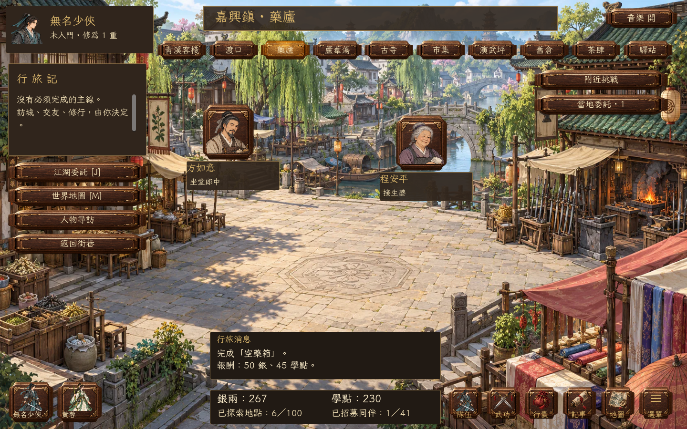

## 一座村、一個人，就能開始你的江湖

「壺是空的，別瞧了。若是來比劍，等我手不抖再說。」

令狐沖不是在等你交三株草藥。他欠了酒錢，一把舊劍還押在山腳；替他問一句，才知道他把挑擔的、看門的都拉上桌喝了。你可以原話帶回酒商的責備，也可以給他找個洗碗還債的位子。

黃蓉在客棧拆穿飯錢騙局，穆念慈想拆掉被旁人拿來下注的擂臺，段譽不肯照玉像留下的話去殺人。你可以聽完便走，也可以管這樁閒事，往後邀他們同行。**沒有必做的第一章，也沒有先清主線才能開地圖的門檻。**

**v0.12.1 · 辦完的事，江湖記得。** 完成任務再找黃蓉，她會談小跑堂現在怎樣護著糖罐；令狐沖會說還酒債的近況。129份委託有各自的事後談話，另有111段其他參與者的回應。聽過後再見面便聊日常，想重問結果可選「聊聊近況」，已完成的委託不再拿來求助。可直接沿用 v0.12.0 存檔。

銀兩、學點、已探索地點、已招募同伴改放在有深色底的固定資訊列。任務消息獨立顯示，長訊息可捲動；滑鼠停在學點可看用途，不再把小金字疊在亮色路面上。

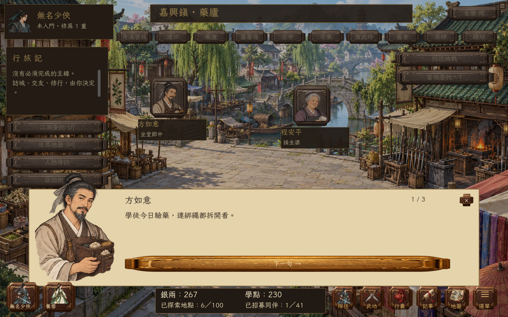

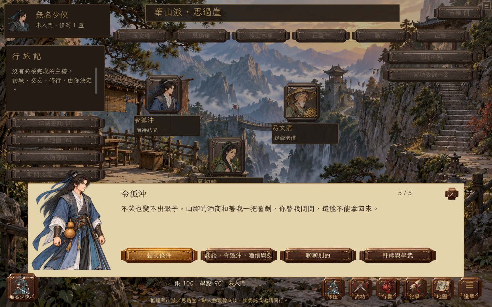

| 去哪裡 | 遇見誰 | 做什麼 | 挑戰誰 |
| --- | --- | --- | --- |
| **16 區域、100 處地點** | **41 位新增可招募人物** | **129 份可選委託** | **100 種獨立繪製對手** |

上述數字只計預設自由江湖，不借用舊版的大資料表。41 人包括 Flash 攻略常見的招募人物、版本有分歧的西夏公主，以及額外高手；半瓶神仙醋也保留為彩蛋人物。每人須先完成自己的往事、累積交情，並達到1–12重的個別修為要求，才願入隊。加上保留的原創同伴，名冊可容納 51 人，四人出戰、主角留隊。舊版已招募的人會保留。

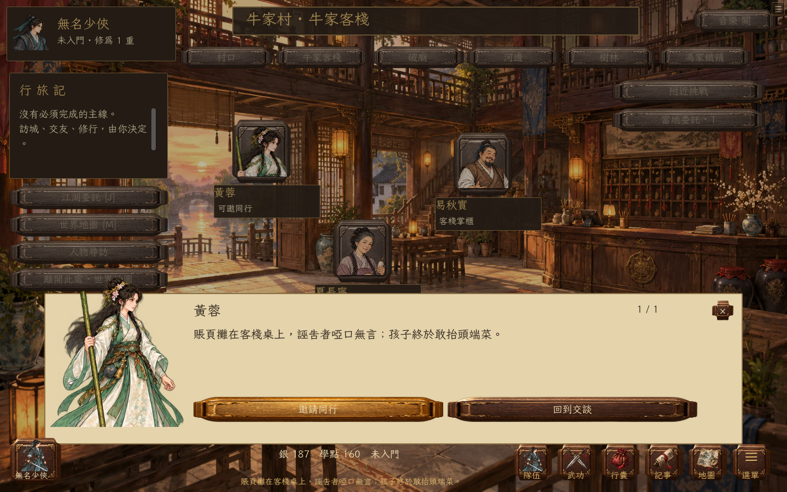

## 經典題材，自由支線

參照《金庸群俠傳3》Flash 正式／1.08 與賀歲版公開攻略，整理 **45 個公告事件槽位**，各自對應本作一份委託：四十二章經、闖王寶藏、唐詩選輯、絕情谷、襄陽守城、擂鼓山棋局、臘八粥……再加上 **41 條同行故事**、**35 條村莊／門派委託**和**8條青溪地方往事**。

黃蓉先提醒你別坐斷腳椅，下一句才承認是她弄斷的。她盯上的騙局藏在一頓飯裡：問魚販的進貨價，看她調換鹽糖，等訛人的客人自己露餡。你幫她打發麻煩，也得和她講清誰付最後這頓飯。對話逐句切換人物頭像，任務階段與選擇會留下相應收尾。

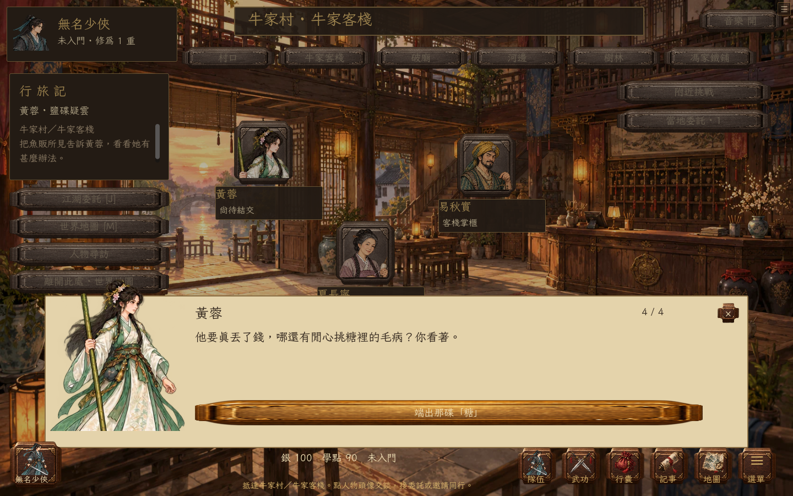

任務會要求交談、尋訪地點、實際交付物品、選擇立場、戰鬥與回報。接下後可在「進行中」追蹤，**前往目標**直接帶你到場景；有對話的步驟會打開正確人物。完成後才發報酬，讀檔保留進度，不重複領取。

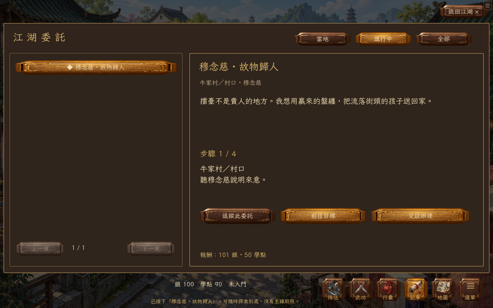

這是依題材**重新編寫的遊戲**，不是原 Flash 的逐字劇本、全部隱藏分支或公式複製。原版五日拜師／一年出師的時間鎖未照搬。研究來源、版本差異、45 項對應與完整招募名冊見 [內容對照](docs/OPEN-WORLD.md) 和 [可機讀清單](docs/JY3-COVERAGE.json)。

v0.12.0 的故事原稿、Lua查閱範圍與流程變更另記於 [劇情重寫](docs/NARRATIVE.md)。16位新配角立繪由內建 imagegen 生成，保存於 `assets/supporting/`；[提示詞與角色順序](art/story-cast/prompts.json)可查閱。

## 先見人，再拔劍

每個地點先呈現場景和至少兩位可交談人物。客棧、渡口等建築在青溪街巷以**入口光圈**表示，進入後才見到掌櫃、船翁等人物頭像；不再拿戰鬥立繪假扮建築。各地使用四張新繪場景背景，因此 **100 處地點並不代表 100 張獨立美術地圖**。

**207 位地方居民與服務人物**有各自姓名、職業及生活對話。32 張新繪居民頭像涵蓋茶博士、船娘、鐵匠、郎中、織娘、驛使、僧人等；分配時檢查整個區域，不讓同城居民撞臉。頭像會在不同城市重用，並非207張獨立人物畫。

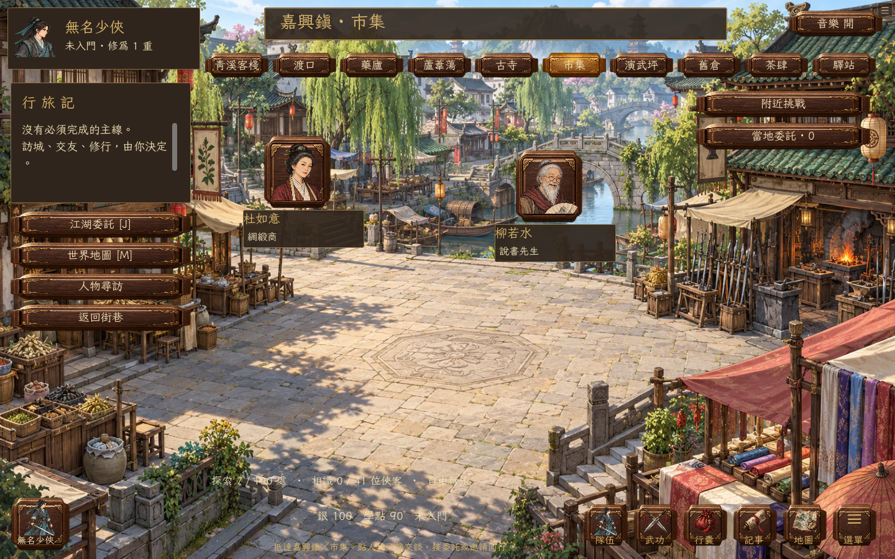

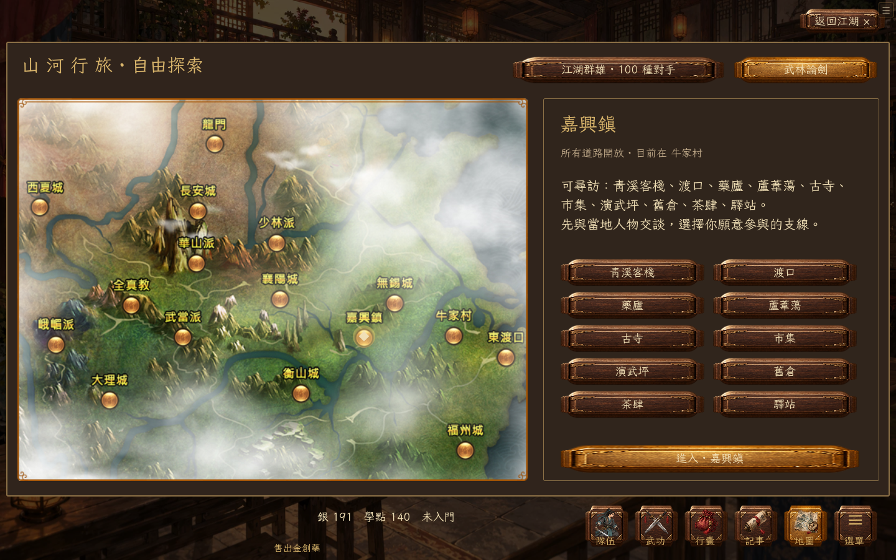

「江湖群雄」列出 100 種有各自立繪、強度、武器和招式的對手，查看所在地後再自願挑戰。守陣、毒傷、越陣、療傷、破甲和蓄力等出招方式，讓相同隊伍也需要不同應對。敵人有強弱階梯，打不過便去交友、研習武學，日後再來。

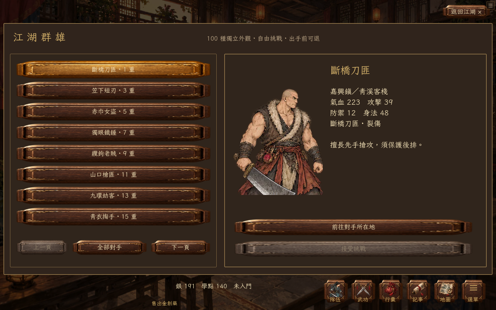

## 四人同行，各有用處

搭配一門外功、一門內功和一門輕功。外功決定兵器與主動招式；內功影響聚氣、氣血和防禦；輕功影響先手與閃避。招募後，主角能在外功選單研習同伴的傳承。

戰前調整上中下路、前後排。每輪選普攻、守勢或施招，再按「進行回合」；按速度依序出手，普攻帶動聚氣，真元與調息限制強招。保住療傷者、用封招阻止蓄力，或讓越陣高手先取後排，都比只堆攻擊有用。

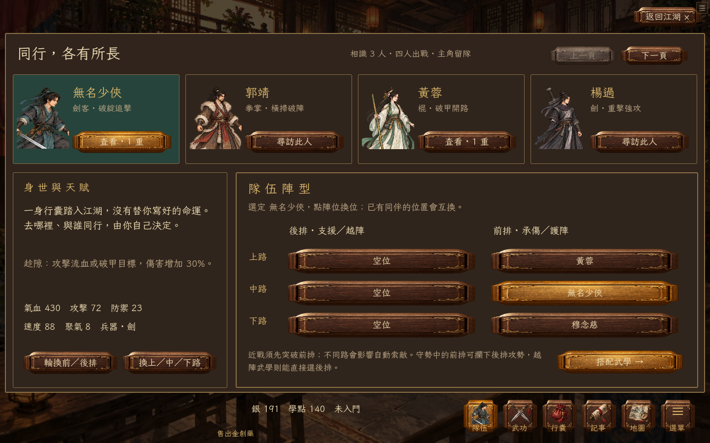

**華山、武當、少林、全真、古墓**可拜師。到師父處消點，或原地自修；自修每完成五秒週期才扣學點、提升修為。兩者均影響實際戰鬥屬性，上限三十重。這是本作的平衡設計。藥品可在各地商店、客棧與指定醫館買賣。

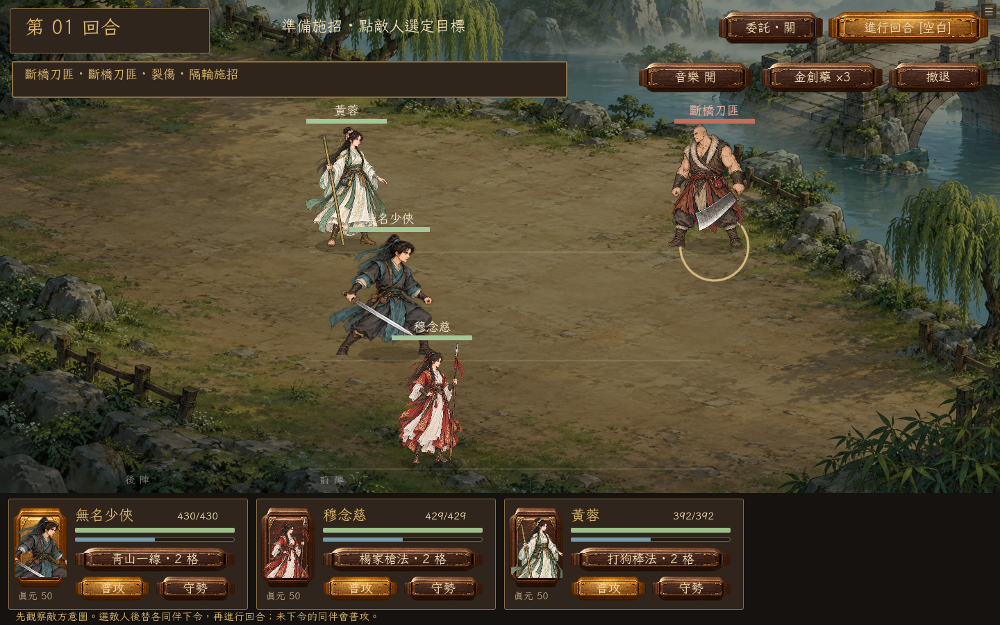

新增立繪以內建 imagegen 繪製。41位新增群俠現在都有站姿、蓄勢、出招、守勢，共164格專用姿勢，黃蓉會實際揮棒。原創角色與兵器配置的60格動作繼續保留；100位敵人仍以站姿配程式突進／受擊。每格依身高與腳底校準；長兵器越過等分線時，依完整人物連通區裁切，必要時用來源區域遮去相鄰人物，沒有改繪PNG像素。[群俠提示詞](art/companions/prompts.json)與[既有動作提示詞](art/visuals/prompts.json)均公開。

龍掌、竹棒、六脈指勁、重劍、雙劍、音律、寒氣、毒霧與療傷使用不同的光效、軌跡與音效。新增19張完整特效圖集、23段起手／命中音效，配置成24種表現類型；蓄力有持續氣場與專用音效，守勢有護盾，毒血、破甲和封招以有底色的標記顯示餘下回合，滑鼠可查看作用。選用資源的來源與雜湊見 [art/combat-fx.json](art/combat-fx.json)。

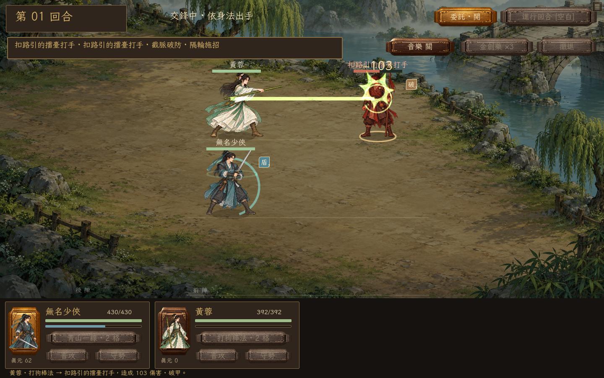

## 隨時保存，重新出發

同一份 Godot 4.6.3 遊戲匯出 Windows 與瀏覽器版。首次約下載 **103 MiB**（含引擎、美術與音樂）；啟動時先驗證分塊，再預載所有群俠姿勢、場景、特效和音效。失敗可重試，已驗證部分繼續使用；暖啟動沿用快取，損壞片段只重抓該段。

進度自動保存。右上 ☰ 可匯出／匯入完整備份，Windows 與網頁可交換。**v0.12.1 可直接沿用 v0.12.0 進度**。首次從 v0.11 或更早版本升級時，先備份再重新開局：備份包含舊角色、同行、物品與任務，可在 **選單 → 匯出重寫前舊檔** 取回；Windows 會打開備份所在資料夾。備份失敗便保留原進度，經典版角色與聲音設定保留。

**選單 → 刪除存檔／重新開始**會另行要求確認；取消保留進度，確認清除本機角色、同行名冊、支線與所有舊備份。清除瀏覽器資料也可能刪除進度。

快捷鍵：**C** 同伴、**K** 武學、**I** 行囊、**J** 委託、**M** 地圖、**D** 每日、**F8** 選單、**Esc** 返回。每日送信、採藥、守爐、運鏢與切磋仍可使用，UTC+8 零時更新。

預設自由江湖是**單機隊伍**。經典版的聯機、副本、生活技能保留在 **選單 → 進入舊版江湖 / F9**。網頁聯機需自行架設 wss:// 房主，Sites 並未附帶雲端遊戲房主。詳見 [網頁部署與存檔](docs/WEB.md)。

## 經典江湖 · 保留的舊版玩法

The following catalogue and sections describe the retained classic game, accessible from Settings. They are **not** counts for the new Qingxi chapter.

| Explore | Meet | Collect | Challenge |
| :---: | :---: | :---: | :---: |
| **270** connected locations | **293** NPCs with distinct dialogue | **174** items | **137** enemy types |
| **11** sects | **12** character storylines | **124** martial arts | **71** artifact commissions |

## 接任務、買補給，從這裡開始

The permanent top bar puts **任務 · 商店 · 行囊** within one click. You can also use the matching lantern menus.

- **任務** — Browse available, active, locked and completed quests. Select one to see its requirements, rewards and next step. Common quests remain visible after joining a sect. Press **前往接任務**, then accept beside the NPC; delivery and reward buttons live in the same journal.
- **商店** — Choose **購買物品** or **出售物品**, select an item and quantity, and confirm the displayed total. Missing money, protected quest items and equipped gear have visible explanations. If no merchant is nearby, the shop finder lists reachable stores and starts travel when selected.
- **行囊** — Use medicine, equip or remove gear, or jump directly to its sale. The shop can also remove equipped gear before you sell it.


## 任務與副本，開始下一段江湖

**20 new source stories** include 金盆洗手上下篇、雲兒、尋找楊康、程清霜送藥、清為尋木、全真送信 and 雁門關拓印. Quest pages now expose scene actions, timed encounters, collection and kill progress. Repeatable quests show cooldowns and retain their completion history.

Open **副本**, choose an entrance and travel there. Solo players can enter directly; parties gather at the entrance and let the leader create the instance. **Every member must ready up before each stage.** Heal between stages, use your own medicine to aid a teammate, and finish all three stages for automatic rewards.

| Instance | Entrance | Required 實戰 | Suggested martial level |
| --- | --- | ---: | --- |
| 黑風寨剿匪 | 黑風林 | 0 | 5 |
| 銅人試陣 | 少林寺・羅漢堂 | 1,000 | 15–25 |
| 血刀密窟 | 血刀門・密室 | 4,000 | 25–35 |
| 高昌秘窟 | 高昌・高昌迷宮外 | 12,250 | 40+ |


Each remaining participant receives one clear reward; the first clear also grants a bonus item and learning points. Cooldowns last 10–30 real minutes. Leaving or losing grants no partial clear reward. Awarded items, clear history and cooldowns persist; unfinished instances reset on reconnect. These are simulator adaptations; the bronze trial does not replace the original sect graduation exam.


Four linked **討伐委託** are available from 揚州城's 江湖懸賞使. Their quest panels link directly to the dungeon page. Complete the instance, then return to the quest journal for the separate bounty.

## 採一簍礦，打一柄自己的劍

**v0.6.0 adds life-skill automation.** Open **生活** in the top bar or press **Ctrl+0**. Choose a skill, follow **尋師** to its teacher, pay the lesson fee and receive its starter tool. The page finds the nearest suitable workplace and shows tools, ingredients, proficiency, success chance and the next action.

**11 skills · 38 recipes · 62 workplaces:** 種田、樵夫、釣魚、廚師、挖礦、打鐵、鑄劍、工匠、織布、裁縫、獵人。

- Choose **1 / 10 / 30 / 100 attempts** or keep working until stopped. Optional **自動打坐** restores energy and resumes work; missing materials or tools still stop the job.
- Turn ore into bars, bars into weapons and tools; spin hemp into thread, weave cloth, then sew clothes. Missing materials link to their gathering skill, recipe or shop. Finished products and harvested goods link directly to selling.
- Each completed attempt spends energy. Success earns proficiency and products; failed crafts keep their ingredients. Hunting uses your actual martial arts in a solo battle, with meat and hides awarded after victory.
- The host owns timers, checks, consumption and rewards in multiplayer. Stop, travel, battle interruptions or loading a save cancel pending work. Proficiency and inventory persist; **there are no offline earnings**.


The life data comes from the supplied JY-Mini OL project. Its proposed recipes, teacher placements and numerical rules retain their source labels; this is not a claim of exact official-server economy. See [life rules and verification](docs/LIFE_SKILLS.md).

## Learn the art. Find your way.

- **門派與師承** — Join 少林、武當、峨嵋、華山、恆山、全真、古墓、靈鷲宮、星宿、血刀門 or 丐幫. Find teachers, meet prerequisites, and work through their teaching limits.
- **消點與自修** — Spend learning points to gain proficiency. 悟性 changes training efficiency; ordinary self-study consumes points and energy every complete five-second cycle. Teachers, basic skills, combat experience and quests constrain progression.
- **游俠控制台** — Automate hunting, instruction, self-study, and healing. Medicines are consumed from your actual inventory; automation stops when conditions cannot be met.
- **故事與探索** — Follow character conversations inspired by Jin Yong's stories, make choices, search for artifacts, and deliver commissions. A searchable codex helps you find people and routes.
- **經典介面** — Parchment, jade, lanterns, a calligraphic font, illustrated landscapes, and a bottom hotbar adapted from JY-Mini OL.
- **江湖聲韻** — Five BGM tracks, scene-aware switching, crossfades, volume and mute controls, and a manual track selector. Preferences are saved locally.

`拜師 → 刷怪 → 學點 → 消點／自修 → 更深的江湖`

### Find the person. Learn the art.

**Find a teacher or a quest giver by name or martial art.** Search the map for a place, person, martial art or learning event. Searching **武當心法** finds its actual teacher; an event art can point to its quest giver. Results show the exact room and distance.

Choose a result to **start travelling immediately**. The world page shows the destination, next stop and full route. Travel follows adjacent rooms one step at a time, stops on arrival, and can be cancelled with **停止**. Changing destination cancels the old journey.


Instruction now spends **one point for proficiency**, rather than granting a full level. Self-study spends **three points every five seconds**, with no credit for an interrupted cycle. Train 讀書識字 to improve 悟性, build lifetime 實戰, meet the teacher's prerequisites, and complete learning events to unlock advanced arts. The 武功 page shows what is missing.

The **49 imported quest definitions** include recommendation letters, conversations, items, trials and learning rewards. This release verifies 26 complete primary quest paths, including the new stories and four previously blocked routes. It does not claim all reference quests or every branch are complete. External, internal, lightness and parry arts have separate selections; combat includes corresponding basic skills, equipment scaling, dodge, move unlocks and inner-power costs.

See the [research and implementation audit](docs/RESTORATION.md) for sources, historical differences and reconstructed coefficients. This build does not claim exact official-server parity.

### Match your art to your weapon

**v0.3.1 fixes martial-art and weapon matching.** The 武功 page shows each art's category, required weapon, foundation and self-study limit. Equip an external art, an internal art and a lightness skill independently.

| Martial art | Required equipment |
| --- | --- |
| 搏擊格鬥 / 基本刺術 / 拳掌指法 | Unarmed or a claw weapon |
| 劍法 / 刀法 | Sword / blade respectively |
| 棍杖 / 槍法 / 鞭法 | Staff / spear / whip respectively |
| 倚天屠龍筆法 | Spear category, following the official classification |
| 內功 / 輕功 | Separate support slots; cannot replace your attack |

Learn **基本劍法** from a teacher before equipping **木劍**. Equipping a weapon selects a compatible art you already know. Use **行囊 → 卸下兵器** to return to unarmed arts. A sword no longer adds damage to fist or staff techniques.


The original basic name **搏擊格鬥** replaces the prototype's 基本拳腳. Old levels and proficiency migrate automatically. See [the rules and sources](docs/MARTIAL_RULES.md) for verified classifications and remaining simulator adaptations.

## Start playing

1. Download the Windows ZIP from [Releases](https://github.com/chon9/Jinyong-Emulator/releases/latest).
2. Extract **all files** into a folder.
3. Double-click **Youxia.exe**. Godot and Python are not required.

Keep the bundled DLLs and `steam_appid.txt` next to the EXE. The game opens in single-player mode and remains playable when Steam is unavailable.

**First steps:** open **任務 → 可接任務** and choose a beginner delivery. Press **前往接任務**, accept at the NPC, follow the next step and claim the reward. Open **商店** for supplies and selling loot. For training, open 地圖 and search **基本刀法** or **基本劍法** to find a武館 teacher. Learn a basic art, return to 揚州城 for the beginner bounty, then work toward your chosen sect's entry requirements. Set gender in 武功 before joining; 武當 and 華山 also need their entry events. Press **F8** for music settings and multiplayer connections.

| Key | Action | Key | Action |
| --- | --- | --- | --- |
| **F1** | 自修 · self-study | **F5** | Save |
| **F2** | 打坐 · meditate | **F6** | Return to the world |
| **F3** | 尋敵 · seek enemies | **F7** | Player interactions |
| **F4** | Use 金創藥 | **F8** | Music & connections |

**Ctrl+1–9** opens 江湖、任務、副本、商店、行囊、武學、地圖、人際、系統; **Ctrl+0** opens 生活; **Esc** returns to the world. The command line also accepts commands such as `拜師 武當`, `自修 基本內功`, `掛機 刷怪`, and `幫助`.

## Play with friends

Build a party of up to **five players**, follow the leader, fight the same enemies, share rewards, and heal an ally with your own medicine. Party chat and private messages go only to their intended recipients.

For a friendly contest, send a **duel invitation**. Both players must agree; health and inner power return to their pre-duel values afterwards. For **wilderness PK**, both players must enable PK, and safe zones remain protected. The loser returns to town with PK switched off.

Trade face to face: choose an item, quantity, and price, then let the other player accept. Items and silver move together after a final inventory check. A price of zero makes it a gift.


### Steam / Spacewar 480

Both players should run the **same game version**, sign into different Steam accounts, and start the game first. The host opens **系統 / F8 → Steam 開房** and shares the lobby ID or uses the invite overlay. Friends join using the lobby ID or Steam invitation.

### LAN / direct connection

Use **區網開房** on the host, then connect to the host's IP. The game uses **UDP 24780**; `127.0.0.1` works for two instances on one computer. Internet direct connections require suitable router/firewall configuration.

The host owns the world and calculates combat, rewards, learning, and trades. Guests' progress is saved by that host. Parties, invitations and unfinished fights are session-only; character progress persists. Host migration is not implemented.

**Verification:** two-process LAN tests cover following, shared battles, trading, duels, PK, private chat and reconnecting. Steam initialization and lobby creation are tested; cross-machine play with two Steam accounts still needs hands-on verification.

## A soundtrack for the road

Town, wilderness, dungeon, ordinary battle, and boss encounters select different tracks. Transitions crossfade, repeated state updates do not restart a song, and combat can return you to the previous ambient playback position. Choose a favorite track or mute the music in **系統 / F8**.


## Saves that stay with you

The standalone Windows game saves to:

```text
%APPDATA%\Godot\app_userdata\網金游俠模擬器\
```

Progress saves every 30 seconds, on F5, and on exit; chapter choices and completed actions also save immediately. A `.bak` copy supports recovery from a damaged main save. Music preferences are separate from character progress. Older characters retain learned levels and items; within-level progress migrates proportionally to the new curve. Travel, combat, unfinished dungeon runs and incomplete study or life-work cycles reset on load. Life proficiency, awarded dungeon rewards and clear records persist. Quest waits retain elapsed world time; repeat cooldowns use real time. Everyone in a classic multiplayer session should use the same build; the transport remains **protocol 7**.

## Build from source

Use **Godot 4.6.3 standard**, with the matching Windows export template. GodotSteam 4.23 is bundled; no separate Steam plugin installation is needed.

```powershell
# Import and run using your own Godot executable
.\tools\run.ps1 -Godot 'D:\Godot\Godot_v4.6.3-stable_win64_console.exe' -Headless -NoSteam -Import
.\tools\run.ps1 -Godot 'D:\Godot\Godot_v4.6.3-stable_win64_console.exe'

# Tests, including local networking
.\tools\test.ps1 -Godot 'D:\Godot\Godot_v4.6.3-stable_win64_console.exe'
.\tools\test.ps1 -Godot 'D:\Godot\Godot_v4.6.3-stable_win64_console.exe' -SocialNetwork

# Windows release ZIP
.\tools\export_windows.ps1 -Godot 'D:\Godot\Godot_v4.6.3-stable_win64_console.exe'
```

The launcher isolates development saves and editor caches under `.tools/`; they are separate from the EXE's normal Windows saves. Release ZIPs go under `build/`. Neither directory is committed.

| Area | Source |
| --- | --- |
| World rules, learning, encounters | [`scripts/world.gd`](scripts/world.gd) |
| Parties, shared fights, PvP, trades | [`scripts/social.gd`](scripts/social.gd) |
| Host authority, snapshots, persistence | [`scripts/session.gd`](scripts/session.gd) |
| Steam lobbies and invites | [`scripts/steam_bridge.gd`](scripts/steam_bridge.gd) |
| Music playback and preferences | [`scripts/bgm.gd`](scripts/bgm.gd) |
| Life work, recipes, learning and automation | [`scripts/life_skills.gd`](scripts/life_skills.gd), [`data/life_skills.json`](data/life_skills.json) |
| Classic UI and controls | [`scripts/classic/`](scripts/classic/) |
| World catalog and stories | [`data/`](data/) |

See [new chapter rules and research](docs/JOURNEY.md), the [classic development and gameplay manual](docs/DEVELOPMENT.md), the [classic restoration audit](docs/RESTORATION.md), and [v0.8.0 release notes](docs/releases/v0.8.0.md).

## Project notes & credits

This is a playable simulator with its own balancing and simplified rules. It does not claim exact parity with a particular historical 網金游俠 version. Character storylines are newly written adaptations, not verbatim novel text; characters from multiple works share this simulated world.

Content, classic UI components, landscape art, and music were supplied through the owner's **JY-Mini OL** project. **LXGW WenKai TC** uses the [SIL Open Font License](assets/fonts/OFL.txt); **GodotSteam** includes its [MIT license](addons/godotsteam/LICENSE.txt). Soundtrack recordings retain their respective owners' rights; see [music provenance](assets/bgm/SOURCE.txt). These third-party notices do not grant a blanket license to all game assets.
