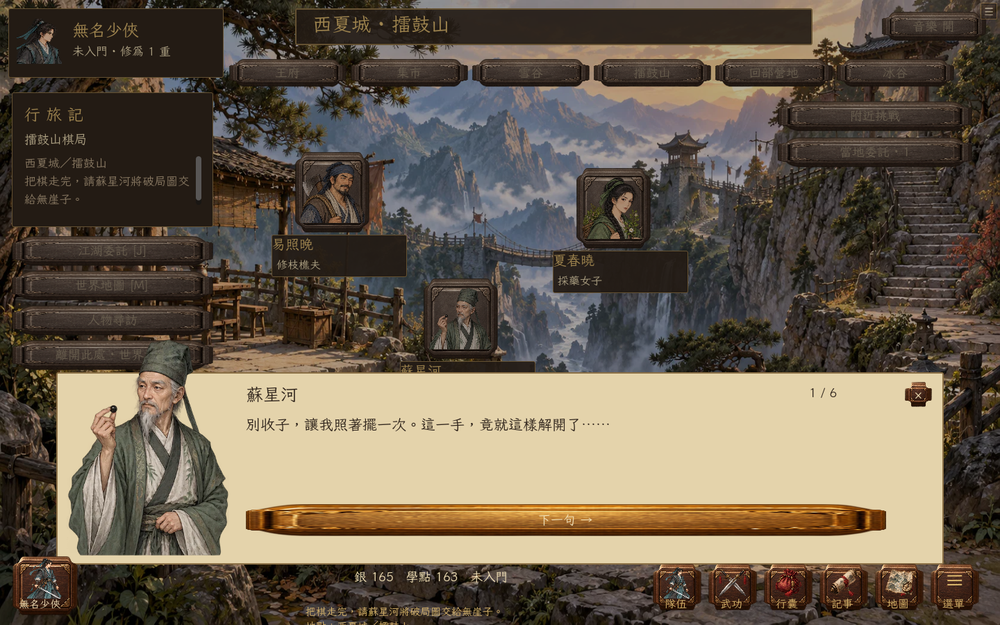

# v0.12.0 劇情重寫

這次修改以重新開局為準。129份支線保留原有題材和人物範圍，重新寫起因、交談、行動與收尾；41位新增可招募人物各有自己的個人往事。它們是本作改寫，不是JYX2逐字劇本移植，也不宣稱等同原著所有情節。

## 人物要先有自己的事

| 人物 | 眼前的事 | 玩家實際做甚麼 |
| --- | --- | --- |
| 黃蓉 | 有人拿飯菜訛人，她已看出破綻 | 找魚販核對帳目、看她設局、打退鬧事者，再談怎樣結清飯錢 |
| 令狐沖 | 酒錢欠得連飯也送不上山，舊劍被扣 | 問酒商、帶回責備或安排挑水還債；沒有強塞的戰鬥 |
| 段譽 | 玉像留下殺人的命令，他不肯照做 | 讀清冊頁，決定撕去命令或封存原冊，只帶走步法 |
| 任盈盈 | 樂師被人堵在碼頭，她親自現身反而連累對方 | 傳一句只有兩人才懂的話、接人、甩開盯梢者 |
| 黃藥師 | 他故意留的空拍，被抄譜人補滿了 | 取譜、辨音；答對免去試招，猜錯才領教他的脾氣 |
| 狄雲 | 被丟的破鞋裡有他不肯丟的舊剪紙 | 問清去向、找回原物，不替他拆開、不逼他講完往事 |

不能只在人物檔案寫「機靈」「豪爽」，對白卻還是同一個人。每份人物稿有口吻、眼前所求、事後反應和同行答覆；短話、遲疑、玩笑也按人物分配。居民另有207段各自的生活談話，其中16段額外見聞談到欠帳、門派流言、城門和同鄉，不一見玩家就教他做事。

## 步驟和選擇要真的不同

不再要求每份任務都有證人、證物、戰鬥、二選一。尋物才把那件物品放入隨身物件；交藥才扣藥；有些事靠交談就能辦完。有選擇的故事保存選擇與相應收尾。

珍瓏棋局答對直接進最後會面，答錯先到林邊聽人解釋，再回棋盤；黃藥師、周伯通的試題可避免或引出切磋；趙敏的營地可選正面交鋒或先除警戒。任我行出牢也有交涉與接招兩條路。並非所有選擇都改變路線，有些改變的是處理方式、交情或最後的談話。

任務進度、報酬和招募門檻由旁白面板顯示，不能讓NPC突然開口報資料欄位。旅途中出現的配角使用自己的名字與立繪；苗人鳳、任我行、蘇星河、瑛姑及梅莊四友不再借一般路人的身分說話。招募仍須完成個人故事、達到交情與各自修為要求。

## 實際讀了哪些Lua

研究目錄：[JYX2 Lua](https://github.com/jynew/jynew/tree/main/jyx2/Assets/Mods/JYX2/Lua)。本機快照為 `773f3e76492f4af277e8c93ced2c8d18ba516f6c`，共1020份檔案；這是目錄規模，不代表逐份精讀。

這次重讀完整的 `ka1`、`ka2`、`ka8`、`ka39`、`ka242`、`ka243`、`ka460`、`ka462`、`ka675`，另按24位主要人物查閱相應談話與條件片段。參考的是人物如何因誤會、好惡、物件、勝負而改口，以及事情前後如何接起來，沒有匯入其Lua程式或逐字對白。

原稿在 `tools/storybook/companions_*.py`、`events_*.py`、`errands_*.py` 和 `town.py`；居民在 `residents_*.py`、`gossip.py`。`tools/jianghu_stories.py` 只把明寫的稿件連到NPC、場景與戰鬥，沒有靠同一段模板替換姓名、物件來產生劇情。

## 重開與備份

首次遇到重寫前的自由江湖，先將完整存檔寫入獨立、按內容雜湊命名的備份，再清空自由江湖進度。逐字驗證備份成功才重開；失敗保留舊角色和任務。新的自由江湖使用 `story_edition: 3`，其後讀檔不再重置。經典版角色、聯機資料和聲音偏好保留。

選項中的「匯出重寫前舊檔」可取得最近一份備份。手動「刪除存檔／重新開始」會清除這些備份，仍需玩家確認。匯入重寫前的存檔會再次先備份再開局，不能用它繞過新版任務條件。

網頁另以同步儲存的短存檔補上IndexedDB非同步寫入的空檔，讀取時以寫入序號選最新一份，刪檔標記也同時適用，避免結案後立即重新整理退回前一步。仍保留Godot檔案存檔與自動備份；[Godot的檔案同步介面](https://docs.godotengine.org/en/4.6/classes/class_javascriptbridge.html#class-javascriptbridge-method-force-fs-sync)本身不提供等待提交完成的回傳值。

## 圖像與驗證

兩張新配角圖集以內建 imagegen 生成，共16位半身立繪，存於 `assets/supporting/`；[提示詞和角色順序](../art/story-cast/prompts.json)公開。生成PNG原樣保留，只用透明區域分析建立裁切、身高校準與鄰格排除資料。

原生測試逐一走完129份支線的兩組選擇，使用真正戰鬥結算，並檢查招募、獎勵只領一次、存讀檔、備份失敗保留進度。瀏覽器測試透過可見按鈕走令狐沖酒債、黃蓉與穆念慈招募、棋局，以及舊檔匯入後的備份下載和重新整理。故事好不好看仍要玩家實際玩；這些檢查只證明流程可走通、狀態和呈現接得上。
